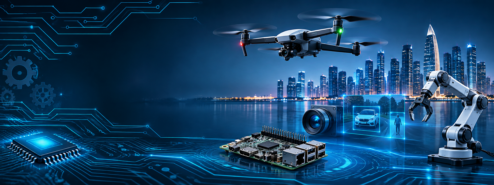

# Khalid Ahmad

### Electrical & Electronics Engineer | Embedded Systems | AI & Computer Vision | UAV & Robotics

**Doha, Qatar**

[LinkedIn](https://linkedin.com/in/khalid-ahmad-17134910b) · [GitHub](https://github.com/khalidmoas) · [Email](mailto:khalidabr40@gmail.com)

---

## About Me

I am Khalid Ahmad, an Electrical and Electronics Engineer with a Master's degree in Embedded Systems and professional experience in electronics engineering, defense industries, research and development, industrial operations, artificial intelligence, computer vision, robotics and unmanned aerial vehicle (UAV) technologies.

My engineering background combines electronic hardware, embedded computing, software integration, intelligent vision systems, technical management and engineering procurement.

Based in Doha, Qatar, I am interested in engineering opportunities involving Embedded Systems, Electronics R&D, UAV Engineering, Artificial Intelligence, Computer Vision, Robotics and Autonomous Systems.

## Engineering Expertise

### Embedded Systems & Electronics
- Embedded Systems Engineering
- Microcontroller-Based Systems
- Embedded Linux
- Electronic Hardware Integration
- Electronics Diagnostics and Troubleshooting
- UART, SPI and I2C Communication
- Sensor Integration
- Raspberry Pi and NVIDIA Jetson Platforms

### Artificial Intelligence & Computer Vision
- Python and OpenCV
- YOLO Object Detection
- Oriented Bounding Box (OBB)
- Vehicle Detection and Recognition
- Object Tracking
- Dataset Preparation and Model Training
- Real-Time Computer Vision
- Edge AI

### UAV & Autonomous Systems
- ArduPilot
- MAVLink Communication
- ROS 2 Humble
- MAVROS
- Software-in-the-Loop (SITL)
- Flight Controller Integration
- UAV Vision-Based Tracking
- Autonomous Motion Control Experiments

### Robotics & Intelligent Systems
- Robotics System Integration
- AI-Based Vision Systems
- Embedded AI
- Sensor and Camera Integration
- Robotic Motion Control
- Hardware and Software Integration

### Engineering Management & R&D
- Technical Research and Development
- Engineering Procurement
- International Supplier Coordination
- Technical Inspection and Testing
- Project Coordination
- Industrial Maintenance
- Technical Operations and Team Supervision

---

## Selected Engineering Projects

### 1. UAV Vision & Autonomous Tracking

Computer vision and UAV integration work involving object detection, tracking and autonomous-system interfaces.

Technologies: Python, YOLO, OpenCV, ROS 2, ArduPilot and MAVLink.

### 2. ROS 2 & ArduPilot Integration

Simulation and testing activities involving flight-controller communication and guided vehicle control.

Work includes:
- Vehicle arming and takeoff.
- Altitude control.
- Guided flight.
- Velocity commands.
- SITL simulation.
- MAVLink communication.

### 3. AI-Based Vehicle Recognition

Computer vision work focused on vehicle detection and recognition under different environmental and image conditions.

### 4. Embedded AI & Robotics

Research and development activities involving embedded computing platforms, sensors, camera systems, robotic platforms and intelligent control.

---

## Professional Experience

### AWG R&D – Technology & Engineering
**June 2022 – September 2026**

Research and development activities involving AI, computer vision, embedded systems, robotics, UAV-related technologies, technical coordination, procurement, component inspection and testing.

### Afrospace / Al-Mustafeen – Rawat Oil Field, Sudan
**Technical Manager | August 2021 – September 2022**

Industrial and oilfield technical operations, heated crude handling, workforce supervision, maintenance coordination and HSE.

### Defense & Military Industries – Sudan
**January 2012 – August 2021**

Engineering experience involving defense electronics, embedded systems, technical R&D, electronic systems integration and testing.

---

## Education

**Master's Degree – Embedded Systems**  
Al-Neelain University

**Bachelor's Degree – Electrical & Electronics Engineering**  
2009

---

## Technical Skills

| Category | Technologies |
|---|---|
| Programming | Python, C/C++ |
| Computer Vision | OpenCV, YOLO, OBB |
| Robotics | ROS 2, MAVROS |
| UAV | ArduPilot, MAVLink, SITL |
| Embedded Systems | Embedded Linux, Microcontrollers |
| Hardware | Matek F722, Jetson Nano, Raspberry Pi |
| Communication | UART, SPI, I2C |

---

## Professional Interests

Embedded Systems Engineering · Electronics R&D · UAV Software and Integration · AI Engineering · Computer Vision · Robotics · Autonomous Systems · Edge AI · Engineering Project Management · Technical Procurement and Testing.

## Contact & Professional Links

**Khalid Ahmad**  
Doha, Qatar

- Email: khalidabr40@gmail.com
- LinkedIn: https://linkedin.com/in/khalid-ahmad-17134910b
- GitHub: https://github.com/khalidmoas

---

**ELECTRONICS | EMBEDDED SYSTEMS | ARTIFICIAL INTELLIGENCE | AUTONOMOUS ROBOTICS**

